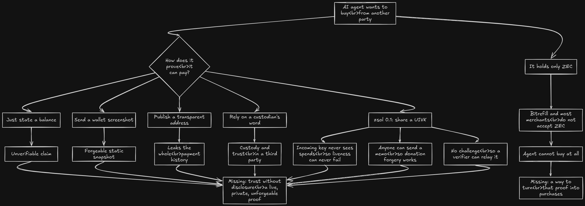
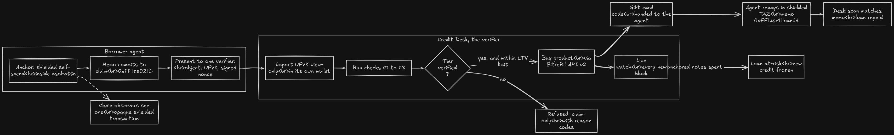
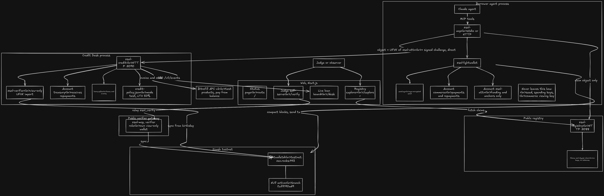
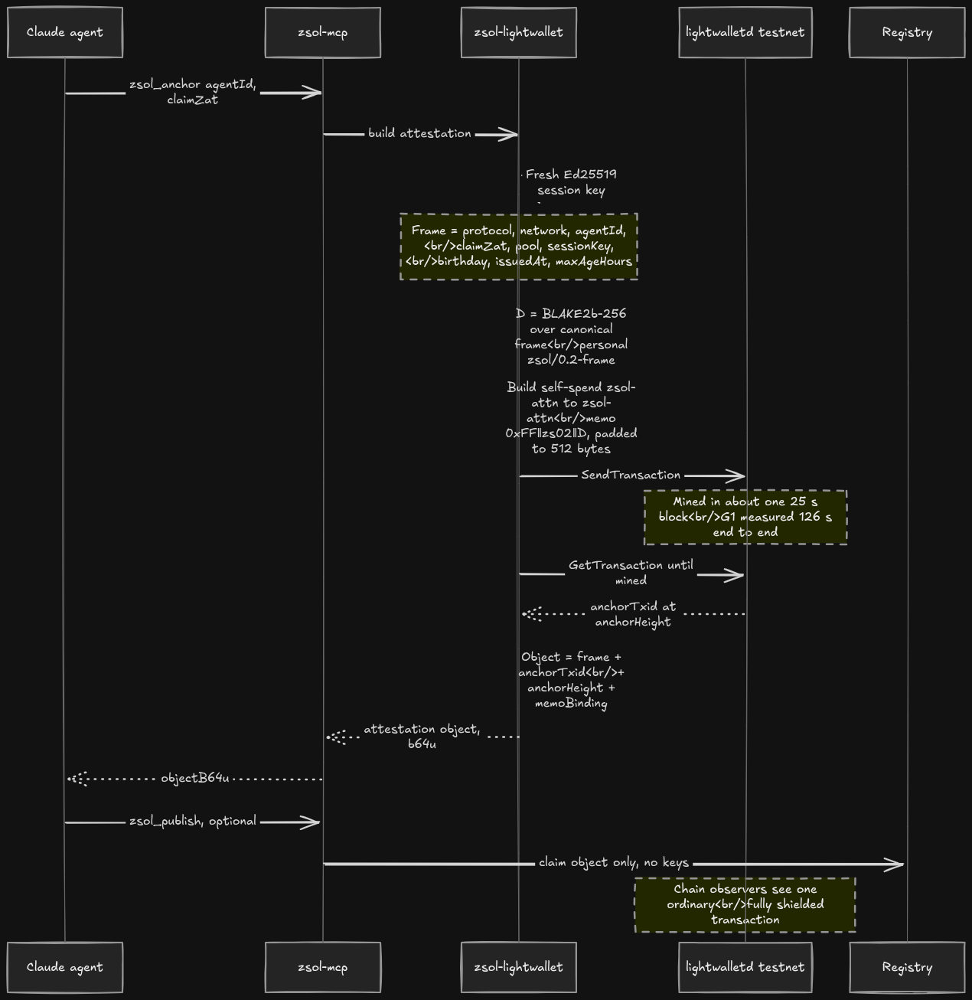
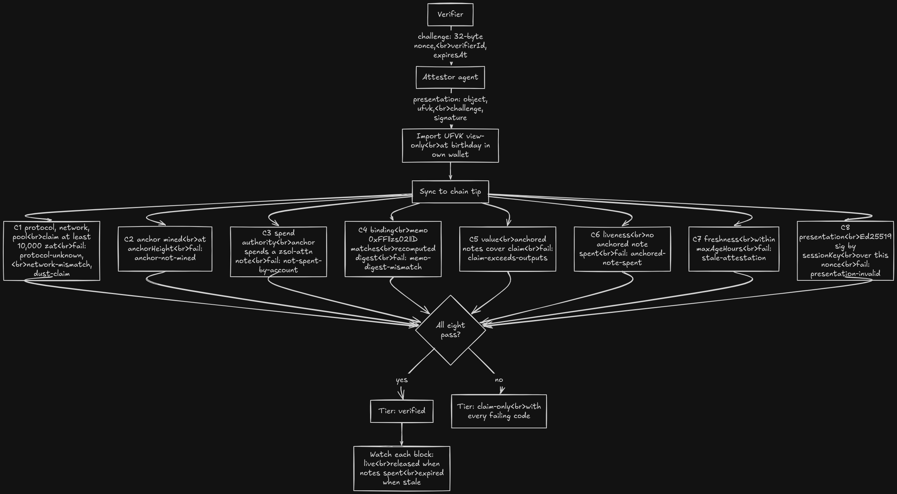
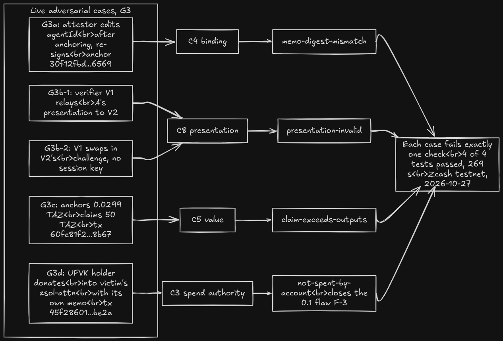
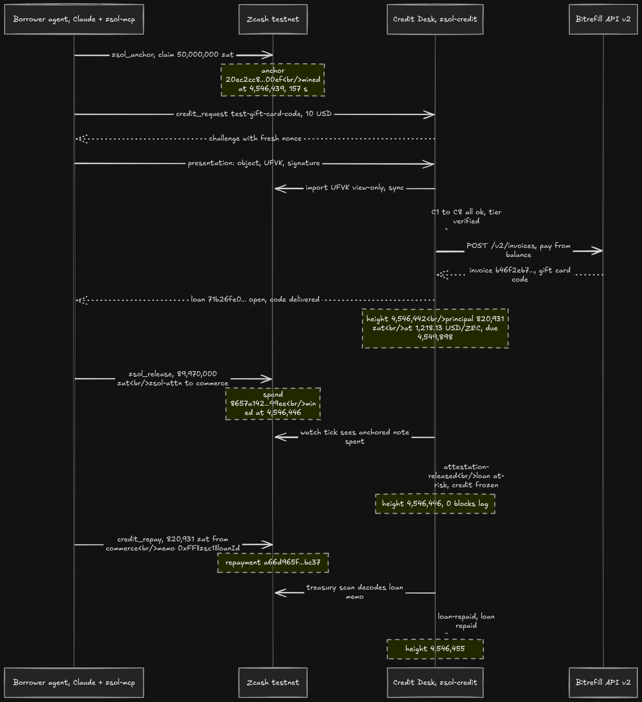
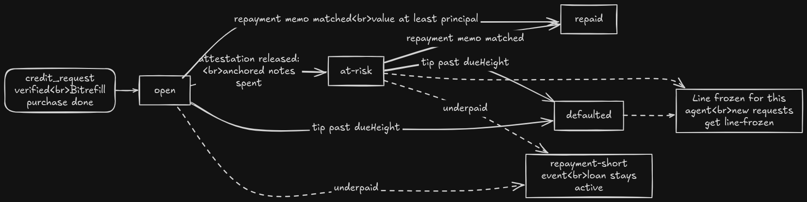

# zsol: provably solvent agents, privately

> **Live, private proof-of-funds for AI agents on Zcash, and a Credit Desk that turns that proof
> into pay-later purchases on Bitrefill.**

**Status:** `pre-alpha`, protocol **0.2**, **Zcash testnet only** (post-NU7, branch `0x77190ad9`).
Requirement-by-requirement status is in [`docs/TODOS.md`](docs/TODOS.md). The spec set is
[`docs/SRS.md`](docs/SRS.md) (v2.0), [`docs/SPEC.md`](docs/SPEC.md) (wire protocol 0.2),
[`docs/BUILD_PLAN.md`](docs/BUILD_PLAN.md) and [`docs/FINDINGS.md`](docs/FINDINGS.md) (why 0.1 was replaced).

---

## What it is

**Privacy track (Zcash).** An AI agent that wants to trade has to show a counterparty it can pay.
Today that means publishing a transparent address (which leaks its whole history), a screenshot,
or a custodian's word. zsol takes a different route. The agent makes a fully shielded self-spend
*anchor* inside a dedicated `zsol-attn` account. The anchor's memo commits to a signed claim
("≥ B zatoshi"). The agent then hands one verifier, and only that verifier, the viewing key for
that one account. The verifier imports it into its own view-only light wallet and checks eight
things: the anchor is mined, it was spent by the account itself (so it cannot be forged by
someone donating to the account), the memo binds the claim, the value covers the claim, the
anchored notes are still unspent, the claim is fresh, and the attestor answers a fresh Ed25519
challenge (so a verifier cannot relay the proof to someone else). The verifier then keeps
**watching**: when the notes are spent, the attestation is `released` within a block. To the
public chain, the anchor is just another opaque shielded transaction, and the public registry
holds no keys and no balances.

**Agentic Commerce track (Bitrefill).** Many merchants, Bitrefill included, do not take ZEC. The
**Credit Desk** is an underwriter agent. It verifies a borrower agent's live zsol attestation,
extends credit up to a loan-to-value limit, buys the product through Bitrefill's API, and hands
the borrower the redemption payload. The borrower repays in **shielded TAZ** with a loan memo,
and the desk detects the repayment by scanning its own wallet. If the borrower's anchored funds
move while a loan is open, the watch flags the loan `at-risk` and freezes new credit. The
borrower agent drives this end to end through MCP tools (`credit_request`, `credit_repay`); the
only human step is approving the spend.

## How it works

**The problem:** an agent must prove it can pay without exposing its balance or history. A proof
that cannot see spends, or that a third party can forge, proves nothing, and the agent still
cannot spend ZEC at Bitrefill.



**The solution:** a shielded self-spend commits to the claim. One chosen verifier gets a view-only
key, runs eight checks and keeps watching every block. The Credit Desk turns a verified claim into
a Bitrefill purchase, repaid in shielded TAZ.



**Architecture and trust boundaries.** The seed, the spending keys and the `commerce` viewing key
never leave the borrower; the registry never sees a key.



### Anchoring an attestation



### Verification: checks C1–C8



### Four attacks, defeated live on testnet (G3)



### The live credit loop (G4 + G5, real heights and txids)



### Loan states



Mermaid sources for every diagram: [`docs/diagrams/`](docs/diagrams/README.md).

## Architecture

| Component | Path | Role |
|---|---|---|
| `zsol-types` | `crates/zsol-types` | Protocol 0.2 core: attestation object, canonical JSON, frame digest (BLAKE2b-256 `zsol/0.2-frame`), memo codecs `0xFF‖zs02‖D` and `0xFF‖zsc1‖loanId`, Ed25519 presentation, reason codes |
| `zsol-lightwallet` | `crates/zsol-lightwallet` | Light-client backend on librustzcash (pinned like `zcash-devtool`) against `testnet.zec.rocks:443`: NU7 boot check, age-encrypted seed, accounts, sync, anchor builder, UFVK export (only `zsol-attn*`), shielded payments |
| `zsol-verifier` | `crates/zsol-verifier` | View-only UFVK import into the verifier's own DB, checks C1–C8, watch tick (`live` / `released` / `expired`) |
| `zsol-cli` | `crates/zsol-cli` | The `zsol` binary, an operator CLI over the three crates above |
| `zsol-mcp` | `crates/zsol-mcp` | MCP gateway (JSON-RPC 2.0 over stdio and streamable HTTP) with attestor, verifier and borrower tools; anything that spends needs `ZSOL_ALLOW_SPEND=1` |
| `zsol-registry` | `crates/zsol-registry` | Public append-only claims registry (SQLite, digest chain, rate limits). It never stores keys |
| `zsol-credit` | `crates/zsol-credit` | Credit Desk: underwriter HTTP API, policy (`config/credit-policy.json`), Bitrefill v2 client, repayment matcher, risk link, SSE events |
| `web` | `web/` | Next.js 16 control plane: `/` status, `/explorer`, `/verify` (judge self-serve), `/desk` (live loan board) |

`crates/zsol-wallet` (the 0.1 Zallet JSON-RPC backend) is parked outside the workspace until a
Zallet release supports NU7 on testnet ([FINDINGS F-8](docs/FINDINGS.md)).

## Quickstart (testnet)

Requirements: Rust (edition 2024), Node + pnpm for `web/`, and network access to
`testnet.zec.rocks:443`. Wallet data lives in `~/.zsol/`, outside the repo. Every command prints JSON.

```bash
cargo build --release -p zsol-cli          # binary: target/release/zsol
alias zsol=$PWD/target/release/zsol

# 1. Boot check: refuses to run unless the endpoint is on testnet and the NU7 branch
zsol chain

# 2. Attestor wallet (accounts commerce + zsol-attn) and an underwriter/verifier wallet
zsol wallet init --dir ~/.zsol/borrower-a --role attestor
zsol wallet init --dir ~/.zsol/underwriter --role underwriter
zsol wallet address --dir ~/.zsol/borrower-a --account zsol-attn --ironwood   # fund this with TAZ
zsol wallet sync    --dir ~/.zsol/borrower-a
zsol wallet balance --dir ~/.zsol/borrower-a

# 3. Anchor a claim (self-spend inside zsol-attn; waits until mined)
zsol attest anchor --dir ~/.zsol/borrower-a --agent-id agent-a --claim-zat 5000000
zsol attest list   --dir ~/.zsol/borrower-a          # copy objectB64u

# 4. Challenge-response verification in the verifier's own wallet
zsol verify challenge --verifier-id underwriter --out ch.json
zsol attest present --dir ~/.zsol/borrower-a --object <objectB64u> --challenge ch.json --out pres.json
zsol verify run --dir ~/.zsol/underwriter --verifier-id underwriter --presentation pres.json

# 5. Solvency watch (one tick): live | released | expired
zsol verify watch --dir ~/.zsol/underwriter --object <objectB64u>
```

Other commands: `zsol wallet send --dir … --from commerce --to <ua> --zat N [--memo-hex …]`,
`zsol attest share-ufvk --dir …` (refuses anything except `zsol-attn*`). Global flags:
`--lwd` / `ZSOL_LWD` and `--network` / `ZSOL_NETWORK`. Set `ZSOL_LOG` for log level.

**Whole stack.** `zsol up` starts the registry, Credit Desk, verifier gateway and web. It is
being added now and is not merged at the time of writing. Until it lands, start each service by
hand:

| Service | Command | Key env |
|---|---|---|
| Registry | `cargo run --release -p zsol-registry` | `ZSOL_REGISTRY_DB` (required), `ZSOL_REGISTRY_BIND` (default `127.0.0.1:8088`) |
| Credit Desk | `cargo run --release -p zsol-credit` | `ZSOL_CREDIT_DIR` (underwriter wallet), `ZSOL_CREDIT_POLICY`, `ZSOL_CREDIT_BIND` (default `127.0.0.1:8090`), `BITREFILL_API_KEY` (from your git-ignored `.env`; never commit it) |
| MCP gateway | `cargo run --release -p zsol-mcp` | `ZSOL_WALLET_DIR`, `ZSOL_REGISTRY_URL`, `ZSOL_CREDIT_URL`, `ZSOL_MCP_HTTP_BIND`, `ZSOL_ALLOW_SPEND`, `ZSOL_SPEND_CAP_ZAT` |
| Web | `pnpm -C web install && pnpm -C web dev` | `NEXT_PUBLIC_REGISTRY_URL`, `NEXT_PUBLIC_MCP_URL`, `NEXT_PUBLIC_CREDIT_URL`, `NEXT_PUBLIC_EXPLORER_TX` |

To give a Claude agent the tools, register the gateway:
`claude mcp add zsol --env ZSOL_WALLET_DIR=$HOME/.zsol/borrower-a -- $PWD/target/release/zsol-mcp`.

## Live testnet evidence

All rows come from real runs against `testnet.zec.rocks:443` (ECC LightWalletD v0.5.4, branch `77190ad9`).

| Gate | What happened | Transaction / artefact | Evidence |
|---|---|---|---|
| G0 | Boot check, wallets created, sync to tip in 8 s | tip 4,544,854 | [`G0-light-backend.md`](docs/evidence/G0-light-backend.md) |
| G0 | Attestor funded with 1 TAZ (Ironwood, shielded; sent by the owner because no faucet was reachable) | `2a4fe529d32bbf049729594d98225b026fce6b31a75ec6ac43e54f5e69523ada` @ 4,544,876 | [`G1-G2-anchor-verify.md`](docs/evidence/G1-G2-anchor-verify.md) |
| G1 | First wallet-built spend (zsol-attn → commerce) | `07514933e2de25639b0d5afb5320fddfbe79bd523f4c19a80db5df3461f7638d` | [`G1-G2-anchor-verify.md`](docs/evidence/G1-G2-anchor-verify.md) |
| G1 | Anchor, claim 0.05 TAZ, 126 s from command to mined | `30f12fbd02f03b18efff3114b7a6e4e9a4fd9ad32f714c3e774eba78f0706569` @ 4,544,949 | [`G1-anchor.json`](docs/evidence/G1-anchor.json) |
| G2 | C1–C8 all PASS → `verified`, in the underwriter's separate wallet, 8 s | (verifies the anchor above) | [`G2-report.json`](docs/evidence/G2-report.json) |
| G3a/b | Edited agentId → `memo-digest-mismatch`; relayed or swapped challenge → `presentation-invalid` | (anchor above) | [`G3-negative-cases.md`](docs/evidence/G3-negative-cases.md) |
| G3c | Over-claim anchor → `claim-exceeds-outputs` | `60fc81f2e06bc3a351c9828b93080ecf930aab6aac15325dda486a6e7f868b67` @ 4,544,995 | [`G3-negative-cases.md`](docs/evidence/G3-negative-cases.md) |
| G3d | UFVK-holder donation forgery (the 0.1 flaw) → `not-spent-by-account` | `45f286019ddebd0aeeeffce9242ae09e0a58215a78f42d3adaf09e295e2ebe2a` @ 4,544,997 | [`G3-negative-cases.md`](docs/evidence/G3-negative-cases.md) |
| G5 precheck | Bitrefill API v2 test-product purchase, made by hand (not yet through zsol-credit) | invoice `23e5ebfa-d900-464f-934b-4c32232065fe` | [`G5-pre-bitrefill-api.md`](docs/evidence/G5-pre-bitrefill-api.md) |
| G4 | `zsol_release` spends the anchored notes → desk watch emits `released`, loan → `at-risk` (0 blocks lag) | spend `8657a142cf9feabd6efa4ab229ccfd8693cb0260f8bf7dca132a58d84d3499ee` @ 4,546,446 | [`G4-G5-credit-loop.md`](docs/evidence/G4-G5-credit-loop.md) |
| G5 | Anchor → `credit_request` (C1–C8 verified) → Bitrefill invoice + code → `credit_repay` → `repaid` | anchor `20ec2cc8…00ef`, invoice `b46f2eb7-c7a8-4f07-a2d9-35de7084b0b2`, repayment `a66d965f136b11b5c54014edc32154a2fb87727274fa515f23a0ae9eeb6cbc37` | [`G4-G5-credit-loop.md`](docs/evidence/G4-G5-credit-loop.md) |
| G5b | Released attestation presented for credit → desk refuses `claim-only` (C6 `anchored-note-spent`), no invoice | release spend `8657a142…99ee` | [`G5b-claim-only.md`](docs/evidence/G5b-claim-only.md) |
| G6 | Tunnel public URL **descoped by the owner**; judges self-verify on the demo laptop (`/verify`) | — | — |

## Honesty notes

- **Testnet only.** Every amount is TAZ, and nothing has touched mainnet.
- **Bitrefill test products.** In `mode: "test"` the Credit Desk buys only Bitrefill's official
  free test products (`test-gift-card-code`, `test-gift-card-link`, `test-phone-refill`, paid
  from balance). The owner recorded on 2026-10-26 that this counts as using Bitrefill (SRS §7 Q1).
  BUILD_PLAN §3 still lists confirming it with the organizers as an owner action.
- **No explorer links yet.** We have not found a public testnet explorer that indexes post-NU7
  blocks. Mining is confirmed through lightwalletd `GetTransaction`, and the txids above can be
  checked against any NU7-aware node.
- **Sharing a UFVK is not free.** The verifier sees the whole history of the `zsol-attn`
  account, and that cannot be revoked. That is why the account is dedicated and separate from
  `commerce`. Revocation means rotating to a fresh account.
- **Not yet met:** NF-1 (the one anchor measured took 126 s, against a 90 s target). For other
  open items see [`docs/TODOS.md`](docs/TODOS.md).
- Regtest results from 0.1 are kept as history and are labelled regtest. They are never
  presented as testnet evidence.

## Disclosure

> *"Protocol, wallet, verifier and Credit Desk core were built before the event (git history
> from 2026-10-25). Built on the day: \<feature\>."* (BUILD_PLAN §4; the on-day feature is
> chosen on Nov 3.)

## Why

In May 2026 an AI auditing framework helped find the Orchard counterfeiting bug that led to the
Ironwood pool, and 2026 discussion largely assumes agents will transact on Zcash. What agents are
missing is not another payment rail but **trust without disclosure**. Every Zcash x402/MPP
facilitator, FROST custody SDK and explorer-MCP we surveyed (Oct 2026) solves payments or
custody. None lets an agent prove it can pay without exposing itself. zsol makes no consensus
changes and forks no dependencies.

## History (0.1)

Protocol 0.1 (2026-10-25/26) used a Zallet JSON-RPC backend and shared a UIVK. An internal audit
([`docs/FINDINGS.md`](docs/FINDINGS.md)) found it broken. An incoming viewing key never sees
spends, so the liveness check could not fail. No Zallet RPC can import a UIVK or an
Orchard/Ironwood UFVK. Memos carried no spend-authority proof. The testnet node it relied on had
stalled before NU7. All 0.1 evidence is from z3 **regtest** (`docs/evidence/G2-regtest-loop.md`,
`T32-T33-claude-mcp.md`, `T46-T48-web.md`). The 0.1 docs `OPERATIONS.md`, `AGENT_RUNBOOK.md`,
`HONESTY_ANNEX.md` and `DEMO_TOPOLOGY.md` are marked superseded. The Docker/z3 compose files
under `docker/` belong to that era.

## License

MIT, see [`LICENSE`](LICENSE).
